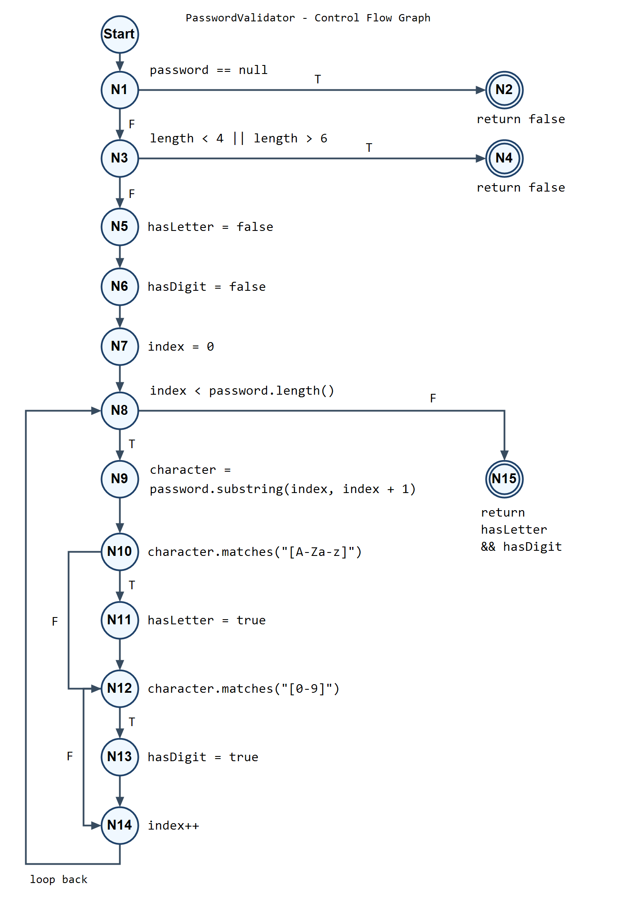

# 密碼檢查器測試報告：Graph Coverage 與 Stress Testing Coverage

- 文件版本：v1.2.0
- 最後更新時間：2026-11-09 14:46
- 作者：Linda Huang
- 對應作業：2) graph coverage（2-1 Edge、2-2 Edge-Pair、2-3 Path）、3) Stress Testing coverage，繳交日 11/7（碩專）

## 目錄

1. [受測程式與控制流程圖](#1-受測程式與控制流程圖)
2. [作業 2-1 Edge Coverage](#2-作業-2-1-edge-coverage)
3. [作業 2-2 Edge-Pair Coverage](#3-作業-2-2-edge-pair-coverage)
4. [作業 2-3 Path Coverage](#4-作業-2-3-path-coverage)
5. [作業 3 Stress Testing Coverage](#5-作業-3-stress-testing-coverage)
6. [測試工具執行結果](#6-測試工具執行結果)
7. [VS Code 環境建置與操作步驟](#7-vs-code-環境建置與操作步驟)
8. [Demo 步驟](#8-demo-步驟)
9. [修改檔案與影響範圍檢查](#9-修改檔案與影響範圍檢查)
10. [變更歷程](#10-變更歷程)

---

## 1. 受測程式與控制流程圖

### 1.1 受測程式

受測程式沿用作業 1 的 `PasswordValidator.isValid`，程式內容與行號完全未修改。它同時具備作業規定的**條件判斷式**（`if`）與**迴圈**（`while`）。

密碼規則：長度 4～6 個字元，且至少包含一個英文字母與一個數字；`null` 一律不合格。

```java
public boolean isValid(String password) {
    if (password == null) {                                  // N1
        return false;                                        // N2
    }
    if (password.length() < 4 || password.length() > 6) {   // N3
        return false;                                        // N4
    }
    boolean hasLetter = false;                               // N5
    boolean hasDigit = false;                                // N6
    int index = 0;                                           // N7
    while (index < password.length()) {                      // N8
        String character = password.substring(index, index + 1); // N9
        if (character.matches("[A-Za-z]")) {                 // N10
            hasLetter = true;                                // N11
        }
        if (character.matches("[0-9]")) {                    // N12
            hasDigit = true;                                 // N13
        }
        index++;                                             // N14
    }
    return hasLetter && hasDigit;                            // N15
}
```

### 1.2 控制流程圖（CFG）

節點沿用 `docs/PasswordValidator-CFG.png` 的 N1～N15。起始節點為 N1，終點節點為 N2、N4、N15。邊依下表編號為 E1～E17，共 **17 條邊**。



| 邊 | 起點 → 終點 | 條件 | 說明 |
|---|---|---|---|
| E1 | N1 → N2 | T | `password == null` 成立 |
| E2 | N1 → N3 | F | 有提供密碼 |
| E3 | N3 → N4 | T | 長度小於 4 或大於 6 |
| E4 | N3 → N5 | F | 長度為 4～6 |
| E5 | N5 → N6 | | |
| E6 | N6 → N7 | | |
| E7 | N7 → N8 | | 第一次進入迴圈判斷 |
| E8 | N8 → N9 | T | 尚未檢查完所有字元，進入迴圈主體 |
| E9 | N8 → N15 | F | 全部字元檢查完畢，離開迴圈 |
| E10 | N9 → N10 | | |
| E11 | N10 → N11 | T | 目前字元是英文字母 |
| E12 | N10 → N12 | F | 目前字元不是英文字母 |
| E13 | N11 → N12 | | |
| E14 | N12 → N13 | T | 目前字元是數字 |
| E15 | N12 → N14 | F | 目前字元不是數字 |
| E16 | N13 → N14 | | |
| E17 | N14 → N8 | | 迴圈繞回（back edge） |

### 1.3 迴圈主體的三條內部路徑

每處理一個字元，迴圈會從 N8 繞一圈回到 N8。依字元種類只有三種可行走法，後續章節以代號表示：

| 代號 | 字元種類 | 迴圈一圈的路徑 |
|---|---|---|
| L | 英文字母 | N8 N9 N10 N11 N12 N14 N8 |
| D | 數字 | N8 N9 N10 N12 N13 N14 N8 |
| O | 其他字元 | N8 N9 N10 N12 N14 N8 |

### 1.4 不可行的測試需求

以下兩種走法在程式邏輯上不可能發生，屬於不可行（infeasible）測試需求，不列入涵蓋率分母：

| 不可行的走法 | 原因 |
|---|---|
| N7 → N8 → N15（迴圈 0 次） | 能走到 N7 代表長度已通過 4～6 的檢查，第一次判斷 N8 必定成立 |
| N11 → N12 → N13（同一圈既是英文又是數字） | 同一個字元不可能同時符合 `[A-Za-z]` 與 `[0-9]` |

### 1.5 最少測試案例數的下限

任何一條完整測試路徑只會停在 N2、N4、N15 其中一個終點。Graph coverage 三種準則都要求走過 E1（停在 N2）、E3（停在 N4）與 E9（停在 N15），因此**至少需要 3 個測試案例**。以下三種準則都以 3 個案例達到 100%，即為最少案例數。

---

## 2. 作業 2-1 Edge Coverage

測試目標：Edge coverage
總共 Edges：E1 E2 E3 E4 E5 E6 E7 E8 E9 E10 E11 E12 E13 E14 E15 E16 E17（共 17 條）
JUnit 類別：`src/test/java/tw/edu/testing/EdgeCoverageTest.java`

### test case 1（測試案例 EC1）

1. Input values（測試時候需要控制資料的值）：`password = null`
2. expected result（正確的結果）：`false`
3. test program's result（程式執行後的結果）：`false`
4. criteria analysis（測試目標的分析）
    - 測試路徑：N1 N2
    - Edge coverage：測試案例涵蓋的 Edges：E1

### test case 2（測試案例 EC2）

1. Input values（測試時候需要控制資料的值）：`password = "a1b"`
2. expected result（正確的結果）：`false`
3. test program's result（程式執行後的結果）：`false`
4. criteria analysis（測試目標的分析）
    - 測試路徑：N1 N3 N4
    - Edge coverage：測試案例涵蓋的 Edges：E2, E3

### test case 3（測試案例 EC3）

1. Input values（測試時候需要控制資料的值）：`password = "abc0"`
2. expected result（正確的結果）：`true`
3. test program's result（程式執行後的結果）：`true`
4. criteria analysis（測試目標的分析）
    - 測試路徑：N1 N3 N5 N6 N7 [L]（a）[L]（b）[L]（c）[D]（0）N15
    - Edge coverage：測試案例涵蓋的 Edges：E2, E4, E5, E6, E7, E8, E9, E10, E11, E12, E13, E14, E15, E16, E17
    - 英文字母走 E11、E13、E15；數字 0 走 E12、E14、E16；最後由 E9 離開迴圈。

### 結果

最少個案例為 3 個案例，總共涵蓋 Edges：E1 E2 E3 E4 E5 E6 E7 E8 E9 E10 E11 E12 E13 E14 E15 E16 E17

**Edge coverage：17/17 = 100%**

---

## 3. 作業 2-2 Edge-Pair Coverage

測試目標：Edge-Pair coverage（每一組連續兩條邊，即長度 2 的路徑，都要被走過）
JUnit 類別：`src/test/java/tw/edu/testing/EdgePairCoverageTest.java`

### 3.1 測試需求

N1 → N2 無法延伸成長度 2 的路徑，依定義以該邊本身列為需求。總共 21 項，不可行 2 項，可行 **19 項**。

| 編號 | Edge-Pair | 涵蓋的測試案例 |
|---|---|---|
| 1 | [N1 N2] | EP1 |
| 2 | [N1 N3 N4] | EP2 |
| 3 | [N1 N3 N5] | EP3 |
| 4 | [N3 N5 N6] | EP3 |
| 5 | [N5 N6 N7] | EP3 |
| 6 | [N6 N7 N8] | EP3 |
| 7 | [N7 N8 N9] | EP3 |
| 8 | [N7 N8 N15] | 不可行（迴圈 0 次） |
| 9 | [N8 N9 N10] | EP3 |
| 10 | [N9 N10 N11] | EP3 |
| 11 | [N9 N10 N12] | EP3 |
| 12 | [N10 N11 N12] | EP3 |
| 13 | [N10 N12 N13] | EP3 |
| 14 | [N10 N12 N14] | EP3 |
| 15 | [N11 N12 N13] | 不可行（同一字元既是英文又是數字） |
| 16 | [N11 N12 N14] | EP3 |
| 17 | [N12 N13 N14] | EP3 |
| 18 | [N12 N14 N8] | EP3 |
| 19 | [N13 N14 N8] | EP3 |
| 20 | [N14 N8 N9] | EP3 |
| 21 | [N14 N8 N15] | EP3 |

與 Edge coverage 的差異：第 14 項 [N10 N12 N14] 必須有一個「既不是英文也不是數字」的字元才走得到，EC3 的 `"abc0"` 沒有涵蓋，因此 EP3 改用含特殊符號的 `"ab1!"`。

### test case 1（測試案例 EP1）

1. Input values（測試時候需要控制資料的值）：`password = null`
2. expected result（正確的結果）：`false`
3. test program's result（程式執行後的結果）：`false`
4. criteria analysis（測試目標的分析）
    - 測試路徑：N1 N2
    - Edge-Pair coverage：測試案例涵蓋的 Edge-Pairs：[N1 N2]

### test case 2（測試案例 EP2）

1. Input values（測試時候需要控制資料的值）：`password = "a1b"`
2. expected result（正確的結果）：`false`
3. test program's result（程式執行後的結果）：`false`
4. criteria analysis（測試目標的分析）
    - 測試路徑：N1 N3 N4
    - Edge-Pair coverage：測試案例涵蓋的 Edge-Pairs：[N1 N3 N4]

### test case 3（測試案例 EP3）

1. Input values（測試時候需要控制資料的值）：`password = "ab1!"`
2. expected result（正確的結果）：`true`
3. test program's result（程式執行後的結果）：`true`
4. criteria analysis（測試目標的分析）
    - 測試路徑：N1 N3 N5 N6 N7 [L]（a）[L]（b）[D]（1）[O]（!）N15
    - Edge-Pair coverage：測試案例涵蓋的 Edge-Pairs：第 3～7、9～14、16～21 項，共 17 項
    - 兩個英文字母相連，走到 [N12 N14 N8] 與 [N14 N8 N9]；數字走到 [N10 N12 N13]、[N13 N14 N8]；特殊符號走到 [N10 N12 N14]。

### 結果

最少個案例為 3 個案例，總共涵蓋 19 項可行 Edge-Pairs（不可行 2 項：[N7 N8 N15]、[N11 N12 N13]）

**Edge-Pair coverage：19/19 = 100%**

---

## 4. 作業 2-3 Path Coverage

測試目標：Path coverage，分為 (1) 沒繞過迴圈、(2) 有繞過迴圈兩類
JUnit 類別：`src/test/java/tw/edu/testing/PathCoverageTest.java`

### 4.1 測試需求

| 分類 | 編號 | Path | 可行性 |
|---|---|---|---|
| (1) 沒繞過迴圈：不經過 back edge E17 的完整路徑 | P1 | N1 N2 | 可行 |
| | P2 | N1 N3 N4 | 可行 |
| | P3 | N1 N3 N5 N6 N7 N8 N15 | 不可行（迴圈 0 次） |
| (2) 有繞過迴圈：迴圈主體每一條內部路徑都要繞回 N8 | P4 | N8 N9 N10 N11 N12 N14 N8（L） | 可行 |
| | P5 | N8 N9 N10 N12 N13 N14 N8（D） | 可行 |
| | P6 | N8 N9 N10 N12 N14 N8（O） | 可行 |
| | P7 | N8 N9 N10 N11 N12 N13 N14 N8 | 不可行（同一字元既是英文又是數字） |

總共 7 項，不可行 2 項，可行 **5 項**。

說明：迴圈每圈有 3 種走法、可執行 4～6 圈，完整路徑共有 3⁴ + 3⁵ + 3⁶ = 1,053 條，無法逐條測試。因此第 (2) 類以「每一條迴圈內部路徑都至少繞回一次」作為測試需求，與投影片 p.36 範例的 Test Paths（125 沒繞過迴圈；1232325 有繞過迴圈）分類方式相同。

### test case 1（測試案例 PC1）

1. Input values（測試時候需要控制資料的值）：`password = null`
2. expected result（正確的結果）：`false`
3. test program's result（程式執行後的結果）：`false`
4. criteria analysis（測試目標的分析）
    - Path coverage (1) 沒繞過迴圈：測試案例涵蓋的 Path：P1 = N1 N2

### test case 2（測試案例 PC2）

1. Input values（測試時候需要控制資料的值）：`password = "a1b"`
2. expected result（正確的結果）：`false`
3. test program's result（程式執行後的結果）：`false`
4. criteria analysis（測試目標的分析）
    - Path coverage (1) 沒繞過迴圈：測試案例涵蓋的 Path：P2 = N1 N3 N4

### test case 3（測試案例 PC3）

1. Input values（測試時候需要控制資料的值）：`password = "ab1!"`
2. expected result（正確的結果）：`true`
3. test program's result（程式執行後的結果）：`true`
4. criteria analysis（測試目標的分析）
    - 測試路徑：N1 N3 N5 N6 N7 N8 N9 N10 N11 N12 N14 N8 N9 N10 N11 N12 N14 N8 N9 N10 N12 N13 N14 N8 N9 N10 N12 N14 N8 N15
    - Path coverage (2) 有繞過迴圈：測試案例涵蓋的 Paths：P4（a、b）、P5（1）、P6（!），迴圈繞 4 圈後由 E9 離開

### 結果

最少個案例為 3 個案例，總共涵蓋 Paths：P1 P2 P4 P5 P6（不可行 2 項：P3、P7）

**Path coverage：5/5 = 100%**

---

## 5. 作業 3 Stress Testing Coverage

依 Testing-Introduction.ppt p.50：測試軟體預期輸入範圍的極限，包含非常大或非常小的值、非常長的字串與空字串、Null 參照，以及無效值。

### 5.1 資料的有效範圍

| 資料 | 有效範圍 | 說明 |
|---|---|---|
| 密碼字串長度 | 4～6 個字元 | `isValid` 的長度規則（N3） |
| 資料筆數 | 4～6 筆 | 迴圈（N8～N14）每次處理一個字元，字元即資料筆數 |
| 密碼內容 | 至少一個英文字母與一個數字 | 極值案例皆使用內容合格的字串，只測試長度極限 |

### 5.2 測試需求

| 編號 | 類別 | 測試需求 | 測試案例 |
|---|---|---|---|
| 1 | 有效範圍內極小值 | 長度 4（迴圈最少 4 筆） | ST1 |
| 2 | 有效範圍內極大值 | 長度 6（迴圈最多 6 筆） | ST2 |
| 3 | 無效值 | 低於下限：長度 3（下限減 1） | ST3 |
| 4 | 無效值 | 超過上限：長度 7（上限加 1） | ST4 |
| 5 | 無效值 | Null 參照（不是字串） | ST5 |

每一項需求是不同的輸入值，一個測試案例只能提供一個值，因此 5 個案例即為最少案例數。

投影片列出的空字串（長度 0）與非常長的字串，分別與長度 3、長度 7 屬於同一種無效值：都在 N3 判定長度不合格，走相同路徑 N1 N3 N4、得到相同結果 `false`，因此不另增測試案例。

JUnit 類別：`src/test/java/tw/edu/testing/StressCoverageTest.java`

### test case 1（測試案例 ST1：有效範圍內極小值）

1. Input values（測試時候需要控制資料的值）：`password = "abc0"`（長度 4）
2. expected result（正確的結果）：`true`
3. test program's result（程式執行後的結果）：`true`
4. criteria analysis（測試目標的分析）：有效範圍 4～6 的極小值 4，迴圈執行最少的 4 次

### test case 2（測試案例 ST2：有效範圍內極大值）

1. Input values（測試時候需要控制資料的值）：`password = "A00000"`（長度 6）
2. expected result（正確的結果）：`true`
3. test program's result（程式執行後的結果）：`true`
4. criteria analysis（測試目標的分析）：有效範圍 4～6 的極大值 6，迴圈執行最多的 6 次

### test case 3（測試案例 ST3：無效值 低於下限）

1. Input values（測試時候需要控制資料的值）：`password = "a1b"`（長度 3）
2. expected result（正確的結果）：`false`
3. test program's result（程式執行後的結果）：`false`
4. criteria analysis（測試目標的分析）：無效值 長度 3（下限 4 減 1），內容雖有英文和數字仍不合格

### test case 4（測試案例 ST4：無效值 超過上限）

1. Input values（測試時候需要控制資料的值）：`password = "abc1234"`（長度 7）
2. expected result（正確的結果）：`false`
3. test program's result（程式執行後的結果）：`false`
4. criteria analysis（測試目標的分析）：無效值 長度 7（上限 6 加 1），內容雖有英文和數字仍不合格

### test case 5（測試案例 ST5：無效值 Null）

1. Input values（測試時候需要控制資料的值）：`password = null`
2. expected result（正確的結果）：`false`，且不拋出 `NullPointerException`
3. test program's result（程式執行後的結果）：`false`
4. criteria analysis（測試目標的分析）：無效值 null，程式在 N1 就結束，不會讀取長度

### 結果

最少個案例為 5 個案例，涵蓋有效範圍極小值、極大值及 3 種無效值

**Stress Testing coverage：5/5 = 100%**

---

## 6. 測試工具執行結果

以下為 2026-11-09 執行 `mvn clean verify org.pitest:pitest-maven:mutationCoverage` 的結果（`reports/` 報告副本維持作業 1 版本，最新結果以 `target/` 重新產生為準）。

### 6.1 JUnit

| 測試類別 | 對應作業 | 案例數 | 結果 |
|---|---|---|---|
| `PasswordValidatorTest` | 作業 1 Line coverage | 9 | 全部通過 |
| `EdgeCoverageTest` | 作業 2-1 | 3 | 全部通過 |
| `EdgePairCoverageTest` | 作業 2-2 | 3 | 全部通過 |
| `PathCoverageTest` | 作業 2-3 | 3 | 全部通過 |
| `StressCoverageTest` | 作業 3 | 5 | 全部通過 |
| `GraphCoverageAnalysisTest` | 作業 2 涵蓋率計算（非受測案例） | 4 | 全部通過 |
| 合計 | | 27 | Failures 0、Errors 0、Skipped 0 |

### 6.2 Graph coverage 涵蓋率計算

JaCoCo 只統計 Line 與 Branch，無法統計 Edge-Pair 與 Path。因此新增 `PasswordValidatorCfg`（CFG 模型）與 `GraphCoverageAnalysisTest`，由 CFG 推導每個輸入的測試路徑並計算涵蓋率；若有任何需求未涵蓋，測試會失敗。執行 `mvn "-Dtest=GraphCoverageAnalysisTest" test` 的輸出：

```text
[Edge] null -> N1 N2
[Edge] "a1b" -> N1 N3 N4
[Edge] "abc0" -> N1 N3 N5 N6 N7 N8 N9 N10 N11 N12 N14 N8 N9 N10 N11 N12 N14 N8 N9 N10 N11 N12 N14 N8 N9 N10 N12 N13 N14 N8 N15
Edge coverage: 17/17 = 100%

[Edge-Pair] null -> N1 N2
[Edge-Pair] "a1b" -> N1 N3 N4
[Edge-Pair] "ab1!" -> N1 N3 N5 N6 N7 N8 N9 N10 N11 N12 N14 N8 N9 N10 N11 N12 N14 N8 N9 N10 N12 N13 N14 N8 N9 N10 N12 N14 N8 N15
Edge-Pair coverage: 19/19 (feasible) = 100%, infeasible: 2

[Path] null -> N1 N2
[Path] "a1b" -> N1 N3 N4
[Path] "ab1!" -> N1 N3 N5 N6 N7 N8 N9 N10 N11 N12 N14 N8 N9 N10 N11 N12 N14 N8 N9 N10 N12 N13 N14 N8 N9 N10 N12 N14 N8 N15
Path coverage: 5/5 (feasible) = 100%, infeasible: 2
```

### 6.3 JaCoCo（各作業單獨執行）

| 測試類別 | Line coverage | Branch coverage |
|---|---|---|
| `EdgeCoverageTest` | 17/17（100%） | 13/16 |
| `EdgePairCoverageTest` | 17/17（100%） | 13/16 |
| `PathCoverageTest` | 17/17（100%） | 13/16 |
| `StressCoverageTest` | 17/17（100%） | 14/16 |
| 全部 27 個測試 | 17/17（100%） | 16/16 |

JaCoCo 的 Branch 以位元碼的「子條件」計算：第 10 行 `length < 4 || length > 6` 有 4 個分支，第 27 行 `hasLetter && hasDigit` 有 4 個分支。CFG 把這兩個複合條件各視為一個節點（N3、N15），因此 Edge coverage 100% 時 JaCoCo Branch 仍可能未滿，未涵蓋的分支是 `length > 6` 成立、`hasLetter` 為 false、`hasDigit` 為 false，屬於作業 4 Logical Expressions coverage（Clause coverage）的範圍，不影響本次 Graph coverage 結論。

### 6.4 PIT

16 個變異全部 KILLED（100%），Line Coverage 17/17。作業 1 的 9 個案例含「只有英文」「只有數字」等輸入，可偵測條件反轉與回傳值變異。

---

## 7. VS Code 環境建置與操作步驟

### 7.1 本機已完成的環境建置

| 項目 | 版本 | 位置 |
|---|---|---|
| JDK（Eclipse Temurin） | 21.0.12.1+1 | `C:\Users\linda.huang\tools\jdk-21.0.12.1+1` |
| Maven | 3.9.9 | `C:\Users\linda.huang\tools\apache-maven-3.9.9` |
| 使用者環境變數 | `JAVA_HOME`、`MAVEN_HOME`，並將兩者的 `bin` 加入 `Path` | Windows 使用者層級 |
| VS Code 擴充套件 | Extension Pack for Java（含 Language Support for Java、Test Runner for Java、Maven for Java、Debugger for Java） | VS Code |
| VS Code 工作區設定 | `.vscode/settings.json`（指定 JDK、Maven）、`.vscode/tasks.json`（Demo 工作） | 專案根目錄，已被 `.gitignore` 排除，只存在本機 |

JDK 與 Maven 採可攜版安裝於使用者目錄，不需要系統管理員權限。其他套件（JUnit 5、JaCoCo、PIT）由 Maven 依 `pom.xml` 自動下載。

### 7.2 在其他電腦重新建置環境

1. 下載 JDK 21（https://adoptium.net/）與 Maven 3.9（https://maven.apache.org/download.cgi）的 zip，解壓縮到任一資料夾。
2. Windows 搜尋「編輯您帳戶的環境變數」，新增 `JAVA_HOME` 指向 JDK 資料夾（不含 `bin`），並在 `Path` 加入 `%JAVA_HOME%\bin` 與 Maven 的 `bin`。
3. 重新開啟 VS Code，在終端機執行 `java -version`、`mvn -version`，確認都顯示 21 與 3.9.x。
4. VS Code 左側「延伸模組」搜尋 **Extension Pack for Java** 並安裝。
5. 從 GitHub 取得專案：`git clone https://github.com/p987654cm/ntou-cse-java-test.git`。

### 7.3 VS Code 操作步驟

1. **開啟專案**：VS Code「檔案 → 開啟資料夾」，選擇包含 `pom.xml` 的 `ntou-cse-java-test-main` 資料夾。
2. **等待 Java 載入**：右下角狀態列顯示 Java 載入完成（大括號圖示不再轉動），左側「Explorer」下方出現「JAVA PROJECTS」與「MAVEN」。
3. **開啟終端機**：按 `` Ctrl+` ``，確認目前目錄為專案根目錄。
4. **執行全部測試**：輸入 `mvn test`，確認 `Tests run: 27, Failures: 0, Errors: 0, Skipped: 0` 與 `BUILD SUCCESS`。
5. **用測試面板執行**：點左側燒杯圖示「Testing」，展開 `tw.edu.testing`，可對單一類別或單一方法按 ▷ 執行；在測試程式中，每個 `@Test` 左側也有 ▷ 可直接執行。
6. **執行 Demo 工作**：按 `Ctrl+Shift+P`，輸入「Tasks: Run Task」，選擇 `HW2-1 Edge coverage（含 JaCoCo 報告）` 等工作。
7. **查看報告**：執行「開啟 JaCoCo 報告」或「開啟 PIT 報告」工作，或在檔案總管開啟 `target/site/jacoco/index.html`、`target/pit-reports/index.html`。

### 7.4 常用指令

| 目的 | 指令 |
|---|---|
| 全部測試 | `mvn test` |
| 只跑 Edge coverage 並產生 JaCoCo 報告 | `mvn "-Dtest=EdgeCoverageTest" clean test jacoco:report` |
| 只跑 Edge-Pair coverage 並產生 JaCoCo 報告 | `mvn "-Dtest=EdgePairCoverageTest" clean test jacoco:report` |
| 只跑 Path coverage 並產生 JaCoCo 報告 | `mvn "-Dtest=PathCoverageTest" clean test jacoco:report` |
| 印出 Graph coverage 計算結果 | `mvn "-Dtest=GraphCoverageAnalysisTest" test` |
| 只跑 Stress coverage 並產生 JaCoCo 報告 | `mvn "-Dtest=StressCoverageTest" clean test jacoco:report` |
| 只跑單一案例 | `mvn "-Dtest=StressCoverageTest#rejectsNull" test` |
| 全部測試、JaCoCo 門檻與 PIT | `mvn clean verify org.pitest:pitest-maven:mutationCoverage` |

---

## 8. Demo 步驟

建議順序如下，全程約 6～8 分鐘。每一步都先開啟測試程式說明案例，再執行指令展示結果。

| 步驟 | 操作 | 展示重點 |
|---|---|---|
| 1 | 開啟 `src/main/java/tw/edu/testing/PasswordValidator.java` 與 `docs/PasswordValidator-CFG.png` | 程式含 `if` 與 `while`；說明節點 N1～N15、邊 E1～E17、終點 N2／N4／N15，以及兩項不可行需求 |
| 1-1 | 開啟 `PasswordValidatorTest.java`，執行 `mvn "-Dtest=PasswordValidatorTest" clean test jacoco:report` | （複習作業 1）9 個案例全部通過，Line 17/17 |
| 2 | 開啟 `EdgeCoverageTest.java`，執行 `mvn "-Dtest=EdgeCoverageTest" clean test jacoco:report` | 終端機顯示 `Tests run: 3`、`BUILD SUCCESS`；說明 3 個案例涵蓋 17 條邊，3 是最少案例數 |
| 3 | 開啟 `target/site/jacoco/index.html`，點進 `PasswordValidator` 原始碼頁 | 總覽表 Lines 的 Missed 為 0（Line 100%）；第 10、27 行為黃色（部分子條件分支未涵蓋，Branch 3 of 16 missed），屬於作業 4 範圍 |
| 4 | 開啟 `EdgePairCoverageTest.java`，執行 `mvn "-Dtest=EdgePairCoverageTest" test` | 說明為何需要 `"ab1!"` 的 `!` 才能走到 [N10 N12 N14]；21 項需求扣除 2 項不可行 |
| 5 | 開啟 `PathCoverageTest.java`，執行 `mvn "-Dtest=PathCoverageTest" test` | 說明 (1) 沒繞過迴圈 P1、P2；(2) 有繞過迴圈 P4～P6；P3、P7 不可行 |
| 6 | 執行 `mvn "-Dtest=GraphCoverageAnalysisTest" test` | 終端機印出每個案例的測試路徑與 `17/17`、`19/19`、`5/5` 涵蓋率 |
| 7 | 開啟 `StressCoverageTest.java`，執行 `mvn "-Dtest=StressCoverageTest" clean test jacoco:report` | 先說明有效範圍 4～6，再展示 5 個案例通過；說明空字串、超長字串與 ST3、ST4 同類，不另增案例 |
| 8 | （選擇性）點 VS Code 左側「Testing」面板，按全部執行 | 以圖形介面展示 27 個測試全部綠色勾勾 |
| 9 | （選擇性）執行 `mvn clean verify org.pitest:pitest-maven:mutationCoverage` | 顯示 `All coverage checks have been met`；PIT 為 16/16 |

截圖建議：每個作業截取「測試程式」與「終端機執行結果」各一張，比照 `docs/Homework1.docx` 的格式貼入 Word 報告。

---

## 9. 修改檔案與影響範圍檢查

### 9.1 修改檔案

| 檔案 | 狀態 | 內容 |
|---|---|---|
| `src/test/java/tw/edu/testing/EdgeCoverageTest.java` | 新增 | 作業 2-1，3 個案例 |
| `src/test/java/tw/edu/testing/EdgePairCoverageTest.java` | 新增 | 作業 2-2，3 個案例 |
| `src/test/java/tw/edu/testing/PathCoverageTest.java` | 新增 | 作業 2-3，3 個案例 |
| `src/test/java/tw/edu/testing/StressCoverageTest.java` | 新增 | 作業 3，5 個案例 |
| `src/test/java/tw/edu/testing/PasswordValidatorTest.java` | 未修改 | 作業 1 的 9 個案例維持原樣，不屬作業 2、3 異動 |
| `src/test/java/tw/edu/testing/PasswordValidatorCfg.java` | 新增 | CFG 模型（邊、Edge-Pair、Path 需求與不可行需求） |
| `src/test/java/tw/edu/testing/GraphCoverageAnalysisTest.java` | 新增 | 計算並驗證三種 Graph coverage 為 100% |
| `pom.xml` | 修改 | JaCoCo agent 改由 Surefire 以相對路徑掛載；PIT 不沿用 Surefire `argLine` |
| `README.md` | 修改 | 新增作業 2、3 的說明、指令與中文路徑注意事項 |
| `docs/Homework2-3.md`、`docs/Homework2-3.html` | 新增 | 本報告 |
| `reports/` | 未修改 | 報告副本維持作業 1 版本；作業 2、3 結果以 `target/` 重新產生為準 |
| `src/main/java/tw/edu/testing/PasswordValidator.java` | 未修改 | 作業 1 的行號與 N1～N15 維持不變 |

### 9.2 修改 pom.xml 的原因

原本由 `jacoco:prepare-agent` 產生 JaCoCo agent 參數，其中 `destfile` 是絕對路徑。專案放在含中文的路徑（例如 `Downloads\軟體正規方法`）時，Windows 傳給測試 JVM 的參數會亂碼，導致 `jacoco.exec` 沒有產生：

- `jacoco:report` 顯示「Skipping JaCoCo execution due to missing execution data file」，沒有 HTML 報告。
- `mvn clean verify` 的 100% 行覆蓋率門檻被略過，仍顯示 `BUILD SUCCESS`，容易誤以為門檻已檢查。

改為由 Surefire 的 `argLine` 掛載 agent，`destfile=target/jacoco.exec` 使用相對路徑，與專案所在路徑無關。

### 9.3 影響範圍檢查

| 呼叫端 | 說明 | 結果 |
|---|---|---|
| `mvn test` | 全部 27 個測試 | 通過，並產生 `target/jacoco.exec` |
| `mvn "-Dtest=…" clean test jacoco:report` | 指定類別或方法，產生 JaCoCo 報告 | 通過，中文路徑下也能產生報告（修改前無法產生） |
| `mvn clean verify` | JaCoCo report 與 100% 行覆蓋率門檻 | 通過，顯示 `All coverage checks have been met`（修改前門檻被略過） |
| `mvn org.pitest:pitest-maven:mutationCoverage`（單獨執行） | README 所列的 PIT 單獨指令 | 建置成功；變異 16/16 KILLED（100%） |
| `mvn clean verify org.pitest:pitest-maven:mutationCoverage` | 全部報告 | 通過 |
| `PasswordValidatorTest`（作業 1） | 未修改，維持 9 個案例 | 9 個案例通過；單獨執行 Line 17/17（100%） |
| README 的 `-Dtest=PasswordValidatorTest#rejectsNull+rejectsTooShort` 範例 | 保留的方法名稱 | 方法仍存在，指令可用 |
| VS Code Testing 面板 | 由 Test Runner for Java 直接啟動 JUnit，不經過 Surefire | 預期不受影響；VS Code 需重新載入視窗後才能實際點擊驗證，請於 Demo 前執行一次 |
| `-Dmaven.repo.local=.m2`（README 選用參數） | agent jar 會位於專案內；若專案路徑含中文，jar 路徑同樣會亂碼 | 修改前後相同的既有限制，未另行驗證；含中文路徑時請勿使用此參數 |

---

## 10. 變更歷程

| 版本 | 時間 | 說明 |
|---|---|---|
| v1.2.0 | 2026-11-09 14:46 | 作業 1 測試還原為原本 9 個案例（不屬作業 2、3 異動）、reports/ 還原為作業 1 版本，同步更新測試總數（27）、JaCoCo Branch（16/16）與 PIT（16/16） |
| v1.1.1 | 2026-11-04 10:55 | 修正第 8 章 Demo 步驟 3：JaCoCo 原始碼頁第 10、27 行實際為黃色（部分子條件分支未涵蓋），原誤寫為全部綠色 |
| v1.1.0 | 2026-10-19 15:42 | 依「使用最少個測試案例」：作業 1 改為 3 個案例；作業 3 移除與長度 3、7 同類的空字串與超長字串，改為 5 個案例；更新工具結果與影響範圍 |
| v1.0.0 | 2026-10-19 15:19 | 初版：Edge、Edge-Pair、Path、Stress Testing coverage 測試案例與分析，VS Code 操作與 Demo 步驟 |
